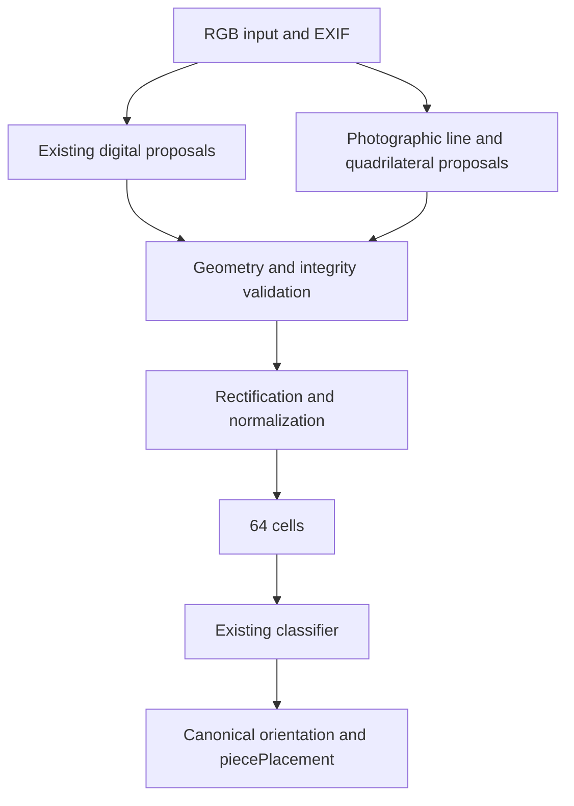

# Detection review for screenshots and photographs

[Español](../es/detection-strategy-review.md) · [Home](README.md)

Date: 2026-10-19. Inspected code: `314d0c6`. **Proposal for review, not an
implementation or compatibility declaration.** The intended product includes
phone photographs of **planar 2D** chess representations on screens and paper,
not physical three-dimensional chess pieces. This scope exceeds the previously
prepared digital acceptance scope.

## Conclusion

The existing separation of stages supports incremental development.
**The current geometry representation cannot handle general perspective photos:**
it only carries an axis-aligned rectangle, and normalization only crops and resizes.
Increasing tolerances cannot remove this limitation.

Keep the digital detector as a fast path, add projective grid proposals for
photographs, and share a geometry contract and rectification before segmentation.
There is no justification to replace the whole detector, introduce another neural
network now, or rewrite the classifier. Reusing its weights is a **hypothesis to
measure on rectified photographs**, not a guarantee.

The next work should collect and annotate a photographic pilot and measure
classification with verified geometry. That separates the effort needed for
localization from the visual domain change affecting classification.

## 1. What the code actually does

| Component | Current implementation | Reuse and necessary changes |
| --- | --- | --- |
| [image_input.py](../../src/boardsnap/image_input.py), `read_image` | Static PNG/JPEG, validation, EXIF orientation, RGB, transparency composited on white. No optical or perspective correction. | Reusable. Flutter must export PNG/JPEG or a future input adapter must support other formats; HEIC is currently unsupported. |
| [detection.py](../../src/boardsnap/detection.py), `detect_board` | Profile palette and connected RGB-edge proposals, plus searches for seven interior boundaries along each axis. | Retain the digital path. Add geometry for quadrilaterals and non-axis-aligned lines. |
| `BoardBounds` / `_BorderGrid` | Integer `(x,y,width,height)` rectangle. Recovery separates visible perimeter from uniform segmentation geometry, both still rectangular. | Preserve this distinction; add projective geometry without silently redefining `BoardBounds`. |
| [normalization.py](../../src/boardsnap/normalization.py), `normalize_board` | Validates bounds, crops and resizes with LANCZOS to 512×512 by default. Keeps a full source copy and `source_bounds`. | Already supports resizing a rectangular crop to a square. Does not accept four corners or correct perspective. Preserve the screenshot path. |
| [segmentation.py](../../src/boardsnap/segmentation.py), `split_squares` | Splits the normalized square into 8×8 independent RGB 64×64 crops in visual order. | Reusable with a correctly rectified grid. |
| [neural.py](../../src/boardsnap/neural.py) | `SquareNet`: initial average pooling, three convolutions and two linear layers, 13 classes. `preprocess`: uint8 RGB N×64×64×3 → float32 NCHW /255, without implicit resizing or additional normalization. | Keep architecture, weights and artifact contract as references. It does not detect or straighten boards. Rectification does not automatically remove photographic appearance changes. |
| [orientation.py](../../src/boardsnap/orientation.py) | Reads glyphs from rectangular source regions; `to_canonical` reorders labels for the selected board view. | Explicit orientation is reusable. Automatic coordinate reading needs transformed regions for a quadrilateral. |
| [pipeline.py](../../src/boardsnap/pipeline.py) and `NeuralClassifier.recognize_image` | Separate template and neural orchestration paths, both detecting, normalizing and segmenting. | Integrate rectification consistently into both; avoid divergent behavior. No general restructuring is needed now. |
| [output.py](../../src/boardsnap/output.py), CLI | `piecePlacement` and errors, without public geometry. | Reusable. New annotation and diagnostic fields must not extend the recognition JSON. |

Specific digital detector restrictions:

- Minimum side 128 pixels is a geometric filter, not a readability guarantee.
- Palette proposals require side differences ≤ `max(2, side×0.01)`. Connected
  edge proposals initially allow 8%, but `_refine_grid` again requires about 1%.
  Interior-line proposal pairing also applies that restriction before refinement.
- `_axis_grids` uses vertical/horizontal morphological openings and uniform
  image-space spacing. `_refine_grid` estimates a start and step per axis, with
  consensus from at least five of seven boundaries. It does not estimate vanishing
  points or a homography.
- `_structural_pattern` resizes to 256×256, estimates two parity backgrounds,
  requires contrast ≥25, at least 52/64 compatible cells, support per row/column,
  and transitions at seven boundaries. It tolerates some marks, not arbitrary
  patterns or lighting.
- `complete_edges=True` verifies alternating backgrounds at four edges. Not every
  historical path invokes it: palette and some component paths use other checks.
  It must not be described as a universal completeness guarantee.
- The later 009/010 recovery requires all seven boundaries on both axes, four
  validated visible edges and only one affected strip ≤8% of a cell, capped at
  six pixels. It synthesizes no content. [Details and evidence](border-grid-recovery.md).

The separate `_book_candidates` path uses grayscale thresholding, a dark contour,
a near-square box, a 256-pixel minimum and a fixed 2.3% frame inset. It targets one
edition of hatched diagrams. Neural recognition calls the default digital detector;
it does not automatically select this book path. The printed template experiment
achieved 126/128 cells but **0/2 complete positions** on its historical held-out
set. This does not establish photographic or general book support. [Local evidence](profiles.md).

The image historically named `lichess-video-004` is now `real-use-25.png`;
the following diagnosis retains its historical results.

## 2. Existing evidence and `lichess-video-004`

This review reuses the diagnostic checks already performed in the conversation.
The local image is 1095×1042. Its approximate visible area `(12,13,1017,994)` is
1005×981, a 2.4% difference relative to height. Interior proposals are x=`(6,1016)`
and y=`(13,994)`, with approximately 126.3- and 122.6-pixel spacing. The inferred
grid dimensions differ by about 3%.

The approximate visible region passes `_structural_pattern`, including its outer
edge check, but refinement rejects the proportions. In the preceding diagnostic,
resizing **only in memory** the whole image height to 1065, 1067 and 1068 produced
detections in all three cases. That supports the geometric explanation; it does
not establish correct bounds or correct classification. Its pieces have not been
tested and its expected position has not been formally verified.

The visible left edge is around x=12 while the inferred grid starts near x=6.
The roughly six-pixel discrepancy might be cropping, a video mask or another
cause; that has not been established. **Do not treat the visible rectangle as
verified grid geometry or declare the board complete without reviewing it.**
The aspect adjustment above is not a production-ready fix.

Other reused evidence:

- [Border recovery validation](../../data/reports/border-grid-recovery-validation.json):
  15/15 development cases and all six original failures pass with both models,
  including negative and CLI checks. Those 15 do not include the new image.
- [Tolerance summary](../../data/reports/neural-tolerance-summary.json):
  36,955 → 37,618 exact boards among 40,236 perturbed variants; 674 paired gains
  and 11 losses, preserving the 3,131 originally correct boards. Its historical
  note about deferred 009/010 failures is superseded by the later detector report,
  not by another weight update.
- [Eleven-loss analysis](tolerance-regressions.md): these are correlated variants,
  not eleven independent photographs.
- Full automatic pipeline replay of the 3,456 previously consulted images remains
  pending. Previous classification using verified bounds does not replace it.

No corpus explicitly annotated as phone photographs was identified in the inspected
manifests/tools. Existing real-use material is screenshots; the book diagrams are
downloaded images. A filename alone does not establish provenance. **This report
contains no measured photographic results.**

## 3. Limitations by stage

| Condition | Localization and integrity | Rectification | Classification |
| --- | --- | --- | --- |
| Slightly unequal horizontal/vertical scales | Near-square filters may reject a valid grid. | Resizing can suffice if boundaries remain aligned, uniform and complete. | Measure the resulting interpolation; new training is not automatically necessary. |
| In-plane camera rotation | Axis projections no longer align with grid lines. | Correct rotation and maintain corner correspondence. | Piece drawings must become upright, not just labels reordered. |
| Out-of-plane tilt / perspective | Lines converge and image-space spacing becomes nonuniform. | A homography for a plane; validate the grid in rectified coordinates. | Test with reference geometry before attributing failure to the model. |
| Reflections or shadows | Destroy contrast and can hide edges. | A homography cannot restore saturated or hidden signal. | Mild tonal correction might help; avoid whitening away piece strokes. |
| Blur, JPEG, screen moiré | Weaken lines or add false frequencies. | Resampling can improve or worsen these effects. | May need real data and training augmentation; missing detail cannot be guaranteed recoverable. |
| Interface, text and frames | Join components or propose the monitor frame. | Rectifying a frame does not prove a board lies inside it. | Incorrect crops can contaminate many cells simultaneously. |
| Asymmetric margins | Already covered by digital tests; image dimensions are not grid geometry. | Separate grid, visible perimeter and search region. | Measure all 64 cell alignments, not just board overlap. |
| Partly cropped board | Interior lines may suggest a complete grid absent from the pixels. | Do not pad or reconstruct missing or obscured cells. | Reject insufficient geometry instead of inventing pieces. |
| Curved paper or lens distortion | Lines can curve. | One homography is insufficient; optical or local deformation correction is a different scope. | Start with flat sheets and normal camera optics. |

A planar homography can correct perspective but does not itself locate the board.
[OpenCV homography tutorial](https://docs.opencv.org/4.13.0/d9/dab/tutorial_homography.html).
Radial/tangential lens distortion is handled separately.
[OpenCV camera calibration](https://docs.opencv.org/4.13.0/dc/dbb/tutorial_py_calibration.html).
The table describes inferences from the code and geometric model, not measurements
on a new photographic dataset.

## 4. Alternatives and recommendation

| Option | Benefits | Drawbacks / decision |
| --- | --- | --- |
| Only widen existing detector tolerances | Small change, useful for unequal scales. | Does not model perspective or rotation and admits more false proposals. Insufficient as the final strategy. |
| Additional geometric route with shared rectification | Preserves screenshots, weights and downstream stages; isolates failure sources. | Requires corners, integrity checks, coordinate mapping and new data. **Recommended.** |
| Replace detection with a learned corner/grid detector | Can learn varied appearance and contexts. | Requires annotations, training, distribution and new regressions; does not independently solve completeness or rectification. Consider only if the geometric route systematically fails the pilot. |
| Page/screen rectangle or calibration checkerboard detector | Inexpensive experimental baseline. | Frame ≠ grid. Pieces, marks and printed backgrounds can defeat calibration-pattern corner detection. Do not assume `findChessboardCorners` solves occupied chessboards. |

Conceptual proposal, not implemented:

The proposal generators are alternatives, not a requirement to always run both
or to change priority for valid digital detections without measurement. The new
route could run when no valid digital proposal exists. If testing finds false
positives in the first route, fix them: a fallback cannot correct accepted errors.
Users should not need to identify a photograph versus a screenshot.

Proposed internal contract: four ordered **grid** corners, a separate visible
perimeter, source↔board transformation and integrity evidence. Keep these out of
public JSON. Retain `BoardBounds` and its crop/resize path for aligned boards;
introduce a geometry type without breaking existing consumers or treating its
bounding rectangle as a substitute for the quadrilateral.

The new route should group segments into two line families, fit a projective grid
using robust consensus, and check perimeter and alternation evidence. Do not
require every intersection to be free of pieces, but do not accept any convex
quadrilateral or extrapolate from only three lines. Correspondence must justify
eight intervals per axis **after** rectification, with distributed observations
and negative controls. Select thresholds through development/validation, not final
evaluation.

Prefer one source-to-classifier-size transformation over a warp followed by several
resizes. OpenCV is already installed and provides `getPerspectiveTransform`,
`findHomography` and `warpPerspective`. Verify source pixel coverage so exterior
padding is not accepted as observed board content.
[Transform reference](https://docs.opencv.org/4.13.0/da/d54/group__imgproc__transform.html).
Preserve digital normalization pixels unless a change is justified: changing the
interpolator can alter existing correct predictions.

**Orientation has two distinct problems.** White/black-bottom describes the chess
view; camera rotation affects the drawings inside cells. `to_canonical` only
handles the first. Rectification must keep drawings upright, establish corner
correspondence without mirroring, and preserve/map external labels if `auto` is
to be used. For the pilot: explicit chess orientation, roughly upright photos
after EXIF and moderate roll. Arbitrary upside-down or 90° photos without reliable
EXIF require additional handling; `black-bottom` does not solve them.

## 5. Proposed reproducible evaluation

No new variants, complete evaluations or training runs were executed to write this
review. Previously obtained measurements are reused.

### Data and controls

1. Reuse annotated development screenshots and existing validation groups across
   styles, backgrounds, sizes, marks and videos. Annotate 004 before incorporation;
   retain its known position/game/video grouping. Predictions are not ground truth.
2. Generate whole-image variants with recorded seeds, matrices and parameters:
   unequal scaling ±1/3/5/10%, roll ±3/8/15°, quadrilateral corner displacements of
   5/10/20% of board side, varied sizes and surrounding contexts. These are
   experimental levels, **not equivalent camera angles or compatibility promises**.
   Preserve content in positives; add intentionally clipped negatives.
3. Separate geometry from visual degradation first: downsampling, controlled blur
   and JPEG, then selected combinations. Record smallest projected cell size,
   valid-pixel masks and transformed geometry ground truth. Avoid exhaustive
   combinations and do not present simulated moiré as real screen evidence.
4. Retain 14-pixel and other incomplete-board controls, 6×6/7×8/9×9 grids, tables,
   windows, empty frames and multiple boards. Report real negatives separately
   from synthetic ones.

Reuse `tools/development_cases.py`, `evaluate_detection.py`,
`build_square_dataset.py`, `bounds_tolerance.py`, and the
`capture_batch.py`/`real_positions.py` import workflow. Identity and partition
guards remain useful; rectangular annotations and box metrics need extension.
Existing perturbations move crop edges and resample; they do not evaluate a
projective camera model. Preserve `test_detection_bounds`, `test_detection_clutter`,
`test_detection_border_grid` and `test_video_development`.

### Photographs to collect now

Initial proposal: **72 positive photographs and 18 negatives**, for investigation,
not final acceptance. Twelve positions: four Lichess, four Chess.com and four
flat printed diagrams. Choose opening, middlegame, endgame and a position adding
scarce classes; use existing screen designs and two specific printed styles.
Check 13-class coverage; this sample count does not guarantee it.

Take six photographs of each position:

| Shot | Suggested condition |
| --- | --- |
| 01 | Frontal, sharp, evenly lit, complete board with margins. |
| 02 | Approximately 15–25° lateral tilt. |
| 03 | Approximately 15–25° vertical tilt. |
| 04 | Moderate combined tilt and approximately 5–10° camera roll. |
| 05 | Frontal, farther away, smaller projected board; record actual resolution. |
| 06 | One real difficulty: mild reflection, shadow or slight blur; record which. Observe screen moiré/banding without assuming it will occur. |

Angles are approximate capture instructions, not calibrated measurements. Keep
all corners and pieces visible in positives. Record strongly obscured cases
separately rather than requiring recognition. Alternate white/black-bottom across
digital positions without using phone rotation as a substitute. Start with the
main 1× camera, no filters or automatic document correction, and preserve original
files. Two phones and two screens, if available, help explore variation; one setup
cannot establish cross-device generalization.

The 18 negatives comprise six scenes without boards, six tables/grids of other
dimensions and six incomplete boards with varied sides and missing amounts.
Derived negatives retain their source board identity.

Suggested folder, **not created**: `.cache/photo-pilot-v1/incoming/`.
Names: `screen-lichess-p01-shot-01.jpg`, `screen-chesscom-p01-shot-01.jpg`,
`paper-p01-shot-01.jpg`. Filenames organize data; they are not runtime labels.
Record hash, source URL or edition/page, verified placement, view, position/game
group, session, phone, screen/paper, conditions, reviewed grid corners and visible
perimeter, clipping/occlusion and reviewer. Save the original screenshot and editor
placement for screens; independently transcribe/review all 64 cells for paper.

All photographs, source screenshots and synthetic variants of a position retain
its partition. Group related game positions too; a new device/session does not
make the same position independent. Preserve inherited partitions. For new
sources, assign groups before experiments (approximately eight development and
four validation positions, adjusted to whole groups). Do not duplicate positions
across partitions or reuse reserved material. Once consulted for development,
this pilot is excluded from future independent acceptance.

### Three separate evaluation paths

| Path | Geometry input | What it isolates |
| --- | --- | --- |
| Reference classification | Verified corners and reference rectification; known transforms for synthetic images | Appearance, resolution and interpolation changes with controlled geometry. |
| Geometry | Automatic corners compared with annotations | Localization, completeness and interior alignment. |
| Complete CLI | Only image, orientation and configured model | Application-facing outcome, including upstream failures. |

Measure corner and interior-intersection errors in pixels and fractions of a cell,
including percentiles and worst cases, not only IoU. Interior checkpoints help
expose curved pages despite apparently correct corners. Record rejection/false
positive counts and denominators, per-class precision/recall, confusion matrices,
exact boards, per-stage latency and CPU RSS (cold process and loaded model;
fixed hardware/thread counts).

Break results down by screenshot/synthetic/screen photo/paper photo, design, size,
marks, device and condition. Compare v8 and the candidate on identical inputs,
recording hashes, data/code version and preprocessing. Report group-level results
as well as image-level results: 72 photos of twelve positions are not 72 independent
tests. No pilot percentage alone establishes 99% product reliability. Subsequently
freeze thresholds and final dataset size before consulting it; do not lower
requirements after observing final failures.

## 6. Prioritized roadmap

| Order | Proposed work | Gate |
| --- | --- | --- |
| A | Review this scope; register 004 and collect the annotated photographic pilot with partitions. | Traceable data, reviewed geometry and explicit distinction between screenshots, screen photos and paper. |
| B | Measure v8/candidate with verified corners; prepare synthetic scenarios and negatives. | Identify localization, rectification and classification failures without speculative training. |
| C | Introduce the geometry contract and rectification tested with reference corners; preserve the digital path. | 64 aligned cells, correct view correspondence, no padding, controlled digital regressions. |
| D | Add rotation/perspective proposals and common integrity validation. Treat unequal scales as a simple instance of the same strategy. | Category/group validation improvements without new negative-control false positives. 004 is a regression, not the sole design target. |
| E | Measure the automatic photographic path. Explore preprocessing/training expansion only for failures with correct geometry. | Condition-level improvements without degrading screenshots, marks or arrows. Validation selects changes; v8/candidate remain references. |
| F | Resume previous step 5: complete regressions and freeze the candidate. | Include full pipeline over 3,456 consulted images, videos, six failures, negatives and photographic development/validation data. Document remaining limitations. |
| G | Resume step 6: distribution and a new acceptance policy. | Installation, weight checksums, CPU, catalog and medium-specific conditions fixed; reuse existing packaging tools. |
| H | Resume step 7: independent final capture/evaluation. | Frozen candidate, prerequisite gates passed, real evidence for each claimed medium. The previous reserved digital set cannot validate photographs or paper. |
| I | Accept measured coverage and integrate Flutter. | Image + orientation, errors and editor; preserve exclusively `piecePlacement`. |

For a first version of the **photographic product described**, projective geometry,
integrity, defined orientation and real screen/paper evaluation are essential if
both media are promised. Limit the printed catalog rather than substituting
synthetic screenshots for evidence. Paper can be investigated in parallel and share
geometry, but its classification requires separate measurement and likely new
font/ink examples; that training need is not yet demonstrated.

Deferrable: every piece/book design, curved pages, ultrawide optics, reflections
erasing pieces, extreme perspective, arbitrary unmarked rotations, complex
restoration and learned detection. A screenshot-only version could be closed
earlier as an explicitly limited milestone, but **it is not the screen/paper camera
product**. This review does not silently change the user's objective.

Do not retrain now. Preprocessing can correct geometry and mitigate mild
degradation; it cannot recover absent information or teach unknown printed symbols.
If reference-corner classification fails, compare mild transforms first, then
prepare training using development photos and realistic variants while keeping
validation and acceptance separate.

## Review boundaries

Only documentation and code/report inspection. No production, dependency, model,
partition-manifest or acceptance-policy changes. No training, final evaluation or
distribution. Existing results are historical evidence; photographic experiments
remain a plan. Preserve v8 and the candidate identified in the tolerance summary.
