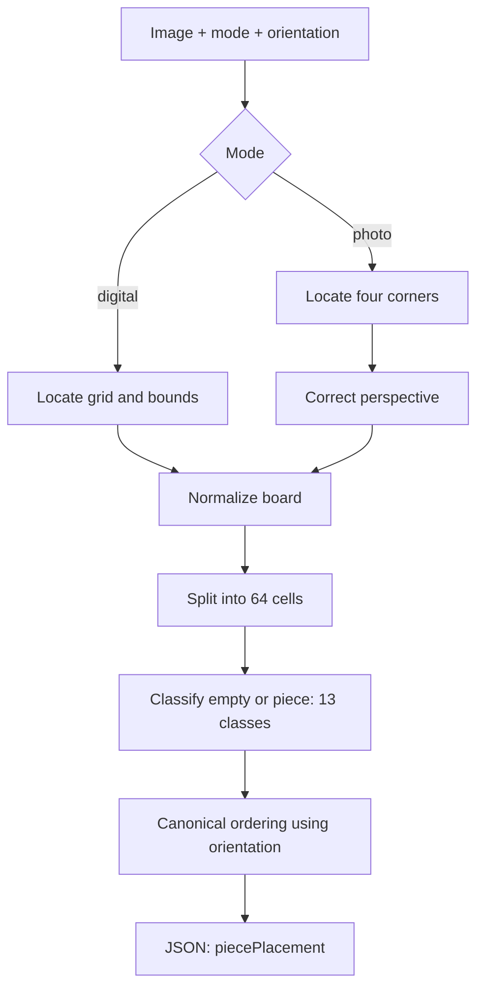
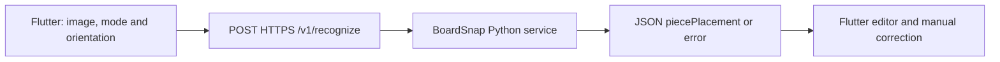

# BoardSnap overall project report

**English** | [Español](../es/project-status.md)

Reviewed **November 17, 2026**. **BoardSnap works as a local engine and trial HTTP
service, with the technical path needed to start Flutter integration.** Digital
screenshots are the more consolidated reference; screen photographs remain
experimental. A final accepted release is not declared.

## Current functionality

PNG/JPEG input produces a single piece placement through two paths:



Photo mode means photographs of **virtual boards on screens**, not physical boards
with three-dimensional pieces. Board/corner detection uses computer vision and
grid geometry; no learned corner detector has been trained. Cell classification
uses PyTorch: a small 39,709-parameter CNN with 64×64 RGB input. Original templates
remain available for reference and compatibility.

The integrated trial requires explicit mode and orientation. Orientation is view,
not turn. Digital `auto` remains available with the existing white-bottom fallback;
photos require explicit orientation. The app does not choose artwork or board theme.

## Output and Flutter responsibilities

```json
{"piecePlacement":"rnbqkbnr/pppppppp/8/8/8/8/PPPPPPPP/RNBQKBNR"}
```

Only FEN's first field is returned, without turn, castling, en passant, counters,
confidence, alternatives or confirmation prompts. Processing failures are structured
errors. Incorrect pieces can be corrected in the app editor. BoardSnap has no UI
or game-analysis responsibilities.

## Architecture and tooling

| Area | Responsibility |
| --- | --- |
| `src/boardsnap/image_input.py` | Decoding, formats, EXIF and input errors |
| `detection.py`, `photo_detection.py` | Digital bounds or photographic corners |
| `normalization.py`, `rectification.py`, `segmentation.py` | Cropping, perspective and 64 cells |
| `orientation.py` | View resolution and canonical order |
| `classification.py`, `neural.py` | Templates and PyTorch classification |
| `output.py`, `pipeline.py` | Piece placement and stage composition |
| `adapters/cli.py`, `adapters/http.py` | Separate transports |
| `tools/` | Capture, annotation, datasets, training, reporting and verification |
| `data/manifests/`, `data/reports/` | Provenance, recipes, partitions, hashes and results |
| `tests/` | Stage and integration tests |
| `docs/en/`, `docs/es/` | Bilingual documentation |
| `.cache/` | Generated local images, crops, models and artifacts ignored by Git |

Tools cover configurable Lichess/Chess.com capture, marks/arrows, photographic
import/review, cell export, overlap audits, reproducible training and class/board/
condition comparisons. Variant volume is not a count of independent games.

## Current models and evidence

| Use | Model | Decision |
| --- | --- | --- |
| Trial screenshots | `neural-tolerance-v1-conservative/best.pt` | Existing digital reference |
| Photographic reference | `neural-phone-v1/best.pt` | Preserved control |
| Trial photos | `neural-mixed-sqrt-v1/last.pt` | Experimental, not promoted |

Full paths/hashes are in [local-trial-v1.json](../../data/manifests/local-trial-v1.json).
References were not overwritten. The photographic candidate tempers inverse-frequency
weights with square root while retaining mixed replay and excluding erroneous teacher
targets on reviewed empty cells. No further training followed the last result.

### Consulted photographic validation

| Metric, 30 photos | phone-v1 | Candidate |
| --- | ---: | ---: |
| Exact boards with annotated corners | 19/30 | 20/30 |
| Exact boards with automatic detection | 20/30 | **22/30** |
| Detected boards | 29/30 | 29/30 |
| Correct cells in the 29 detected photos | 1,824/1,856 | **1,839/1,856** |
| False pieces, automatic crops | 3 | **2** |
| Missed pieces, automatic crops | 18 | **8** |

The complete flow gains `chesscom-img_5398` and `video-img_5406`, retaining all twenty
baseline successes. Candidate category results are 6/10 Chess.com, 8/10 Lichess and
8/10 video.

Seven positions remain incorrect: `chesscom-img_5395`, `5397`, `5401`, `5402`,
`lichess-img_5391`, `5392`, `video-img_5404`; `video-img_5403` fails detection.
Difficulties include thin pawns, piece colour/type confusion, wood, moire and strong
screen interference. Both thin-pawn photo positions still fail. See [CLI details](mixed-sqrt-cli.md).

**22/30 is not a user-facing accuracy promise.** This is a small, consulted
model-selection set with partially unresolved historic provenance. Annotated and
automatic crops produce different results. The candidate still fails original
annotated-corner preservation gates: five false pieces versus three for phone-v1.
Performance or HTTP parity does not override that failure.

### Digital evidence: keep models and datasets distinct

The recent 36 real screenshots/original-regression comparison used **phone-v1**
versus the photographic candidate: 35/36 versus 33/36. The candidate loses
`real-use-6` and `real-use-12`; both solve the six original cases. This is why trial
digital mode does not use the photographic model.

The selected **conservative digital model** solves 40/40 representative validation
screenshots in the recent CPU run. This differs from the 36-image real batch;
phone-v1's 35/36 is not attributed to the conservative model. Broader historic
corpora/regressions must likewise be interpreted with their exact model/version.

## Style coverage

Digital data includes Lichess Cburnett, Alpha, Merida and Staunty; Chess.com Neo,
Classic, Bases and Alpha, on plain backgrounds and some textures. Examples cover
both orientations, sizes, margins, highlights, circles, dots, arrows and crossings.
This does not establish every combination.

The photographic catalogue has seven target entries and fourteen planned pairs,
including observed appearances not consistently mapped to official selectors.
They are not seven certified official themes. Browser screenshots do not establish
native mobile-app compatibility; monitor photos do not establish arbitrary camera,
screen, glare, blur or perspective support. Book diagrams remain outside this first
version even though historic tools/work exist.

## Data and recent training

The digital plan has 80 positions with all variants kept within their partition.
Mixed training combines digital data with 160 previous and 24 targeted photos:
184 photographic boards, not 184 independent games. A fixed 32,000-cell sample
controls source proportions. Image/position/group/split identities and observed
overlap audits are retained. Unknown historic origins prevent full independence
claims.

Bounded experiments tested mixed replay, excluding erroneous empty-cell teacher
targets, and square-root weighting. The latter partially improves validation but
does not authorize automatic further experiments or relaxed gates. Independent
final evaluation was not consumed by these tasks.

## CPU time and memory

Intel Core i5-10400, Linux, four PyTorch threads and one OpenCV thread, one resident
model:

| Pipeline | Median | p95 | Peak RSS |
| --- | ---: | ---: | ---: |
| Screenshot, conservative digital model | 0.448 s | 0.519 s | 317 MiB |
| Photograph, experimental candidate | 1.040 s | 2.782 s | 427 MiB |

Isolated 64-cell classification takes approximately 1.3 ms; most photo time is in
earlier stages. Local thresholds pass. These are not phone, network or two-model
HTTP server measurements. See [methodology](local-trial.md).

## HTTP and Flutter status

The implemented adapter loads/verifies models, parses bounded multipart uploads,
selects mode/orientation, cleans temporary files and returns JSON/errors with
version headers and configurable CORS. Eight cases match the CLI over local HTTPS
with certificate verification. Thirteen additional live request/CORS checks and
97 targeted tests pass. See [adapter report](http-server.md).

No public deployment or Flutter client exists yet. Actual Android, iOS and Flutter
web clients have not been tested. The intended path is:



The current state supports starting a **trial app**. It is not offline recognition;
on-device execution would require export/native runtime work and mobile benchmarks.

## Remaining steps for a first trial application

1. Connect Flutter: multipart bytes, `inputType`, orientation and configurable URL.
   Handle service/network errors and load placement into the editor.
2. Make the service reachable from devices, with HTTPS, web origins, versioned
   weights and deployment limits/capacity. Local testing does not replace deployment.
3. Test Android, iOS and web, including cancellation, timeout, retries and correction.
4. Keep photographic mode experimental and collect useful reviewed failures without
   mixing them into final evaluation.
5. Before an accepted release, freeze scope/policy and run independent evaluation.
   Results used for correction become development material and require another
   independent set.

Photographic recognition improvements can proceed alongside Flutter. Resolving
every difficult photo is not required to try the app, but limitations and the
separation between consulted development and independent evaluation must remain clear.
