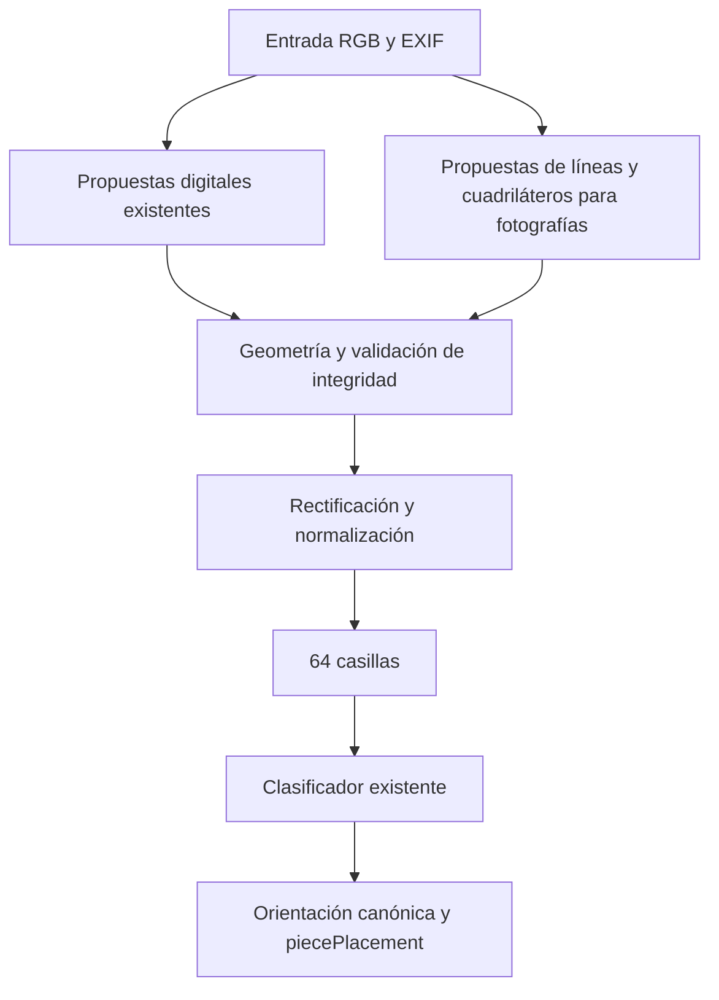

# Revisión de detección para capturas y fotografías

[English](../en/detection-strategy-review.md) · [Inicio](README.md)

Fecha: 2026-10-19. Código inspeccionado: `314d0c6`. **Propuesta para revisión, no
implementación ni declaración de compatibilidad.** El producto objetivo incluye
fotografías de representaciones **planas y 2D** en pantallas y papel; no piezas
físicas tridimensionales. Este alcance es mayor que el de la aceptación digital
preparada anteriormente.

## Conclusión

La separación actual por etapas es adecuada y permite una evolución incremental.
**La representación geométrica actual no basta para fotografías con perspectiva:**
solo transmite un rectángulo alineado con la imagen, y la normalización únicamente
recorta y escala. Aumentar tolerancias no corrige esta limitación.

Recomiendo conservar el detector digital como ruta rápida, añadir propuestas de
cuadrícula proyectiva para fotografías y compartir un contrato geométrico y una
rectificación antes de la segmentación. No hace falta sustituir todo el detector,
introducir otra red ahora ni reescribir el clasificador. Reutilizar sus pesos es
una **hipótesis que debe medirse sobre fotos rectificadas**, no una garantía.

El siguiente trabajo debería ser recoger y anotar un piloto fotográfico y medir
la clasificación con geometría verificada. Después se podrá decidir qué esfuerzo
corresponde al detector y cuál al dominio visual del clasificador.

## 1. Qué hace realmente el código

| Componente | Implementación actual | Reutilización y cambio necesario |
| --- | --- | --- |
| [image_input.py](../../src/boardsnap/image_input.py), `read_image` | PNG/JPEG estáticos, validación, EXIF, RGB y transparencia sobre blanco. No corrige óptica ni perspectiva. | Reutilizable. Flutter deberá exportar PNG/JPEG o una futura entrada deberá admitir otros formatos; HEIC no está admitido actualmente. |
| [detection.py](../../src/boardsnap/detection.py), `detect_board` | Propuestas por colores del perfil y por bordes RGB conectados; búsqueda adicional de siete líneas interiores por eje. | Conservar como ruta digital. Necesita una representación adicional para cuadriláteros y líneas no alineadas. |
| `BoardBounds` / `_BorderGrid` | Rectángulo entero `(x,y,width,height)`. La recuperación distingue perímetro visible y geometría uniforme, pero ambos siguen siendo rectángulos. | Reutilizar esa distinción; añadir geometría proyectiva sin redefinir silenciosamente `BoardBounds`. |
| [normalization.py](../../src/boardsnap/normalization.py), `normalize_board` | Comprueba límites, recorta y redimensiona con LANCZOS a 512×512 por defecto. Conserva copia completa del origen y `source_bounds`. | Ya admite un recorte rectangular y lo convierte en cuadrado. No admite cuatro esquinas ni transforma perspectiva. Conservar el camino actual para capturas. |
| [segmentation.py](../../src/boardsnap/segmentation.py), `split_squares` | Divide el cuadrado normalizado en 8×8 recortes RGB de 64×64 en orden visual. | Reutilizable sin cambiar su responsabilidad si recibe una cuadrícula correctamente rectificada. |
| [neural.py](../../src/boardsnap/neural.py) | `SquareNet`: promedio inicial, tres convoluciones y dos capas lineales; 13 clases. `preprocess`: uint8 RGB N×64×64×3 → float32 NCHW /255, sin redimensionado implícito ni normalización adicional. | Mantener arquitectura, pesos y contrato como referencias. El modelo no detecta ni endereza tableros; rectificar no elimina automáticamente el cambio visual de una foto. |
| [orientation.py](../../src/boardsnap/orientation.py) | Busca caracteres en cajas rectangulares del origen; `to_canonical` reordena etiquetas para blancas/negras abajo. | La orientación explícita se reutiliza. La lectura automática requiere transformar sus regiones; no funciona automáticamente sobre un cuadrilátero nuevo. |
| [pipeline.py](../../src/boardsnap/pipeline.py) y `NeuralClassifier.recognize_image` | Existen dos recorridos de coordinación: plantillas y neuronal. Ambos detectan, normalizan y segmentan. | Al añadir rectificación hay que conectar ambos y evitar divergencias. No hace falta una reestructuración general ahora. |
| [output.py](../../src/boardsnap/output.py), CLI | Construcción de `piecePlacement` y errores; sin geometría pública. | Reutilizables. Las nuevas anotaciones y diagnósticos no deben ampliar el JSON de reconocimiento. |

Restricciones concretas del detector digital:

- Lado mínimo de 128 píxeles: es un filtro geométrico, no garantía de legibilidad.
- Las propuestas por paleta exigen diferencia de lados ≤ `max(2, lado×0.01)`;
  los componentes de bordes admiten inicialmente hasta 8 %, pero `_refine_grid`
  vuelve a exigir aproximadamente 1 %. La combinación de líneas interiores
  también aplica ese límite antes del ajuste.
- `_axis_grids` utiliza aperturas verticales/horizontales y separaciones uniformes
  en la imagen. `_refine_grid` ajusta paso e inicio por eje con consenso de al
  menos cinco de siete líneas. No estima puntos de fuga ni una homografía.
- `_structural_pattern` reduce el candidato a 256×256, estima dos fondos por
  paridad y exige contraste ≥25, al menos 52/64 casillas compatibles, apoyo por
  fila/columna y cambios en las siete divisiones. Tolera algunas marcas, no
  cualquier patrón o iluminación.
- `complete_edges=True` comprueba alternancia en los cuatro bordes. No todas las
  rutas históricas invocan ese control: paleta y algunos componentes usan otras
  comprobaciones. No debe describirse como una garantía universal de integridad.
- La recuperación posterior de 009/010 exige siete líneas en ambos ejes, cuatro
  bordes visibles y una sola franja afectada ≤8 % de casilla, con máximo seis
  píxeles. No sintetiza contenido. [Detalles y resultados](border-grid-recovery.md).

El perfil impreso `_book_candidates` es distinto: umbral de gris, contorno oscuro,
rectángulo casi cuadrado, mínimo 256 píxeles e inset fijo del 2,3 % del marco.
Está ligado a una edición de diagramas tramados. El flujo neuronal llama al
detector digital predeterminado; no selecciona automáticamente ese perfil de
libros. El experimento impreso con plantillas obtuvo 126/128 casillas y **0/2
posiciones completas** en su antiguo conjunto reservado. No demuestra soporte
fotográfico ni de libros generales. [Fuente local](profiles.md).

## 2. Evidencia disponible y diagnóstico de `lichess-video-004`

Se reutilizan las comprobaciones ya realizadas en esta conversación. La imagen
local mide 1095×1042. Su área visible aproximada `(12,13,1017,994)` mide
1005×981: diferencia del 2,4 % respecto al alto. Las propuestas interiores son
x=`(6,1016)` e y=`(13,994)`, con pasos de unos 126,3 y 122,6 píxeles. La geometría
extrapolada difiere aproximadamente un 3 % entre ejes.

El área visible aproximada supera `_structural_pattern`, incluso con comprobación
exterior, pero el ajuste descarta la proporción. Como sondeo diagnóstico se
redimensionó **solo en memoria** el alto de toda la imagen a 1065, 1067 y 1068;
las tres variantes produjeron una detección. Eso respalda la causa geométrica,
no prueba límites correctos ni clasificación correcta. No se han comprobado las
piezas de esta captura ni verificado formalmente su posición.

Además, el borde visible empieza en x≈12 y la cuadrícula extrapolada en x≈6:
hay unos seis píxeles de discrepancia a la izquierda. No está determinado si
proceden de un recorte, una máscara del vídeo u otra causa. **No usar el rectángulo
visible como verdad geométrica ni declarar íntegro el tablero sin revisarlo.**
La corrección de proporciones anterior no es una solución lista para producción.

Otros resultados reutilizados:

- [Validación de recuperación](../../data/reports/border-grid-recovery-validation.json):
  15/15 casos de desarrollo y seis fallos originales corregidos con ambos modelos;
  controles negativos y CLI. Estos 15 no incluyen la nueva `lichess-video-004`.
- [Resumen de tolerancia](../../data/reports/neural-tolerance-summary.json):
  36 955 → 37 618 tableros correctos entre 40 236 variantes; 674 ganancias y
  11 pérdidas pareadas, con los 3131 aciertos originales conservados.
  Su anotación histórica de 009/010 pendientes queda superada por el informe
  de recuperación posterior, no por una nueva modificación de pesos.
- [Análisis de las 11 pérdidas](tolerance-regressions.md): son variantes
  correlacionadas; no equivalen a once fotografías independientes.
- El recorrido completo sobre las 3456 imágenes ya consultadas sigue pendiente;
  la evaluación previa con límites verificados no lo sustituye.

En los manifiestos y herramientas inspeccionados no se ha identificado un corpus
anotado como fotografías de móvil. «Uso real» identifica capturas de pantalla;
los diagramas existentes son imágenes descargadas. No se deduce el origen de
una imagen solo por su nombre. **No hay resultados fotográficos en este informe.**

## 3. Qué puede fallar y en qué etapa

| Condición | Localización e integridad | Rectificación | Clasificación |
| --- | --- | --- | --- |
| Escalas horizontal/vertical ligeramente distintas | El filtro casi cuadrado puede descartar una cuadrícula válida. | Un resize puede bastar si las líneas siguen alineadas, uniformes y completas. | Medir el remuestreo resultante; no implica entrenamiento nuevo por sí solo. |
| Giro de la cámara en el plano | Proyecciones sobre x/y dejan de coincidir con las líneas. | Corregir el giro y mantener el orden de esquinas. | Las piezas deben quedar verticales, no solo las casillas ordenadas. |
| Inclinación fuera del plano / perspectiva | Líneas convergen; separaciones dejan de ser uniformes en la foto. | Homografía para una superficie plana; validar la cuadrícula en coordenadas rectificadas. | Evaluar con geometría de referencia antes de atribuir errores al modelo. |
| Reflejos o sombras | Destruyen contraste y pueden ocultar bordes. | Una homografía no recupera señal saturada u oculta. | Normalización tonal suave puede ayudar; evitar blanqueado que borre piezas. |
| Desenfoque, JPEG, muaré de pantalla | Debilitan líneas o introducen falsas frecuencias. | El remuestreo puede atenuar o agravar el problema. | Puede requerir datos reales y aumentos de entrenamiento; no se garantiza restaurar detalle perdido. |
| Interfaz, texto, marcos | Pueden unir componentes o proponer el marco del monitor. | Rectificar solo el marco no prueba que dentro haya un tablero. | Un recorte incorrecto contamina muchas casillas a la vez. |
| Márgenes asimétricos | Ya hay pruebas digitales; la geometría no debe inferirse del tamaño total. | Separar cuadrícula, perímetro visible y región de búsqueda. | Medir alineación de las 64 casillas, no solo solapamiento del tablero. |
| Tablero parcialmente cortado | Algunas líneas interiores permiten extrapolar un tablero inexistente en los píxeles. | No rellenar ni reconstruir casillas fuera de imagen o tapadas. | Rechazar geometría insuficiente; no inventar piezas. |
| Papel curvado o distorsión de lente | Las líneas pueden curvarse. | Una sola homografía no basta; corrección óptica o deformación local sería otro alcance. | Primero delimitar hojas planas y óptica normal. |

La homografía es apropiada para una representación plana y permite corregir su
perspectiva; no es un algoritmo que encuentre automáticamente el tablero.
[OpenCV: homografía y corrección de perspectiva](https://docs.opencv.org/4.13.0/d9/dab/tutorial_homography.html).
La distorsión radial/tangencial de la lente se trata separadamente de esa
transformación. [OpenCV: calibración](https://docs.opencv.org/4.13.0/dc/dbb/tutorial_py_calibration.html).
Los comportamientos de la tabla son inferencias del código y del modelo geométrico,
no mediciones de un nuevo corpus fotográfico.

## 4. Alternativas y recomendación

| Alternativa | Ventajas | Inconvenientes / decisión |
| --- | --- | --- |
| Ampliar únicamente tolerancias del detector actual | Cambio pequeño; útil para escalas desiguales. | No modela perspectiva o giro; aumenta candidatos falsos. Insuficiente como estrategia final. |
| Ruta geométrica adicional + rectificación compartida | Conserva capturas, pesos y etapas posteriores; permite medir cada fallo. | Requiere esquinas, integridad, mapeo de coordenadas y nuevos datos. **Recomendada.** |
| Reemplazar todo por un detector aprendido de esquinas/cuadrícula | Puede aprender apariencia y contextos variados. | Necesita anotaciones, entrenamiento, distribución y regresiones nuevas; no resuelve por sí solo integridad ni rectificación. Valorar solo si la ruta geométrica falla sistemáticamente en el piloto. |
| Rectángulo de página/pantalla o detector de damero de calibración | Baseline económico para experimentos. | Marco ≠ cuadrícula. Piezas, marcas y fondos impresos pueden impedir detectar las esquinas de un patrón de calibración. No asumir que `findChessboardCorners` resuelve tableros ocupados. |

Propuesta conceptual, aún no implementada:

Las dos rutas son alternativas; no se propone ejecutar siempre ambas ni cambiar
la prioridad de detecciones digitales válidas sin medirlo. La segunda podría
activarse al faltar una propuesta digital válida. Si las pruebas muestran falsos
positivos de la primera ruta, deberán corregirse: un fallback no los arregla.
No se exigirá al usuario indicar si adjunta una foto o una captura.

Contrato interno propuesto: cuatro esquinas de la **cuadrícula**, orden consistente,
perímetro visible separado, transformación origen↔tablero y evidencia de integridad.
No transmitir estos datos a la salida pública. Conservar `BoardBounds` y su camino
de crop/resize para el caso alineado; añadir un tipo de geometría sin romper los
consumidores existentes ni convertir su bounding box en sustituto del cuadrilátero.

La ruta nueva debería agrupar segmentos en dos familias de líneas, ajustar una
cuadrícula proyectiva con consenso robusto y contrastarla con el perímetro y la
alternancia. No exigir que todas las intersecciones estén libres de piezas; tampoco
aceptar cualquier cuadrilátero convexo o extrapolar solo desde tres líneas.
La correspondencia debe justificar ocho intervalos por eje **después** de
rectificar, con suficientes observaciones repartidas y controles negativos.
Los umbrales concretos se elegirán con desarrollo/validación, no con evaluación final.

Usar una única transformación del origen al tamaño de clasificación cuando sea
posible, evitando warp seguido de varios resize. OpenCV ya está instalado y
ofrece `getPerspectiveTransform`, `findHomography` y `warpPerspective`; hay que
comprobar la cobertura de píxeles para no aceptar su relleno exterior como datos
del tablero. [Referencia de transformaciones](https://docs.opencv.org/4.13.0/da/d54/group__imgproc__transform.html).
La ruta digital debe mantener sus píxeles de normalización mientras no se justifique
un cambio: otro interpolador podría alterar aciertos existentes.

**Orientación tiene dos problemas distintos.** Blancas/negras abajo describe la
vista ajedrecística; un giro de la cámara describe los dibujos dentro de cada
casilla. `to_canonical` solo resuelve el primero. La rectificación debe conservar
la verticalidad de las piezas, resolver la correspondencia de esquinas sin reflejos
y preservar/mapear coordenadas exteriores si se pretende usar `auto`. Para el
primer piloto: orientación ajedrecística explícita, foto aproximadamente derecha
tras EXIF y giro moderado. Fotos arbitrariamente invertidas o giradas 90° sin
EXIF fiable necesitan una solución propia; no quedan resueltas por `black-bottom`.

## 5. Evaluación reproducible propuesta

No se han generado nuevas variantes, ejecutado una evaluación completa ni entrenado
modelos para redactar este informe. Se reutilizan las métricas anteriores.

### Datos y controles

1. Reutilizar capturas anotadas de desarrollo y grupos de validación existentes,
   incluyendo estilos, fondos, tamaños, marcas y vídeos. Anotar la 004 antes de
   incorporarla; agruparla con su posición/partida/vídeo conocido. No usar etiquetas
   predichas como verdad.
2. Crear variantes de imagen completa con semilla, matriz y parámetros registrados:
   escala desigual ±1/3/5/10 %, giro ±3/8/15°, cuadriláteros con desplazamientos de
   esquina del 5/10/20 % del lado, distintos tamaños y fondos de contexto.
   Son niveles experimentales, **no ángulos de cámara equivalentes ni soporte prometido**.
   Evitar perder contenido en los positivos; añadir recortes intencionados negativos.
3. Separar primero geometría, después degradación visual: reducción de resolución,
   desenfoque y JPEG controlados; luego una selección de combinaciones. Registrar
   tamaño de casilla más pequeño, máscara válida y verdad geométrica transformada.
   No generar todas las combinaciones ni presentar muaré simulado como muaré real.
4. Mantener los controles de 14 píxeles y demás incompletos, cuadrículas 6×6, 7×8,
   9×9, tablas, ventanas, marcos sin tablero y dos tableros. Los negativos reales
   deben tener su propio informe, además de los sintéticos.

Reutilizar `tools/development_cases.py`, `evaluate_detection.py`,
`build_square_dataset.py`, `bounds_tolerance.py` y el circuito de importación de
`capture_batch.py`/`real_positions.py`. Sus controles de identidad y partición
sirven; los límites rectangulares y métricas de cajas tendrán que ampliarse.
Las perturbaciones actuales son desplazamientos de bordes y remuestreos, no una
evaluación de cámara proyectiva. Conservar las pruebas `test_detection_bounds`,
`test_detection_clutter`, `test_detection_border_grid` y `test_video_development`.

### Qué fotografías tomar ahora

Propuesta inicial: **72 fotos positivas y 18 negativas**, para investigación,
no para aceptación final. Doce posiciones: cuatro de Lichess, cuatro de Chess.com
y cuatro diagramas impresos planos. Elegir apertura, medio juego, final y una
posición que aporte clases escasas; usar diseños existentes para pantallas y dos
estilos impresos concretos. Revisar cobertura de 13 clases; este lote no la garantiza.

Para cada posición, seis fotografías del mismo tablero:

| Toma | Condición orientativa |
| --- | --- |
| 01 | Frontal, nítida, luz uniforme, tablero completo con margen. |
| 02 | Inclinación lateral de unos 15–25°. |
| 03 | Inclinación vertical de unos 15–25°. |
| 04 | Inclinación combinada moderada y giro de cámara de unos 5–10°. |
| 05 | Frontal más lejana, menor tamaño aparente; anotar resolución real del tablero. |
| 06 | Una dificultad real: reflejo leve, sombra o leve desenfoque; registrar cuál. En pantalla observar también muaré/bandas, sin dar por hecho que aparecerán. |

Ángulos aproximados de captura, no mediciones calibradas. Mantener siempre las
cuatro esquinas y piezas visibles en los positivos. Los casos con oclusión fuerte
se marcan aparte, sin forzar una etiqueta de «debe reconocer». Alternar vista de
blancas/negras entre posiciones digitales, sin girar el teléfono como sustituto.
Usar inicialmente cámara principal 1×, sin filtros ni corrección automática de
documentos; conservar los originales. Dos teléfonos y dos pantallas, si están
disponibles, ayudan a explorar variación; con un solo equipo no afirmar generalización.

Las 18 negativas: seis escenas sin tablero, seis tablas/cuadrículas de otras
dimensiones y seis tableros incompletos variando lado y cantidad perdida. Mantener
la identidad del tablero original en los negativos derivados.

Carpeta sugerida, **no creada**: `.cache/photo-pilot-v1/incoming/`.
Nombres: `screen-lichess-p01-shot-01.jpg`, `screen-chesscom-p01-shot-01.jpg`,
`paper-p01-shot-01.jpg`. Los nombres ayudan a organizar, no son etiquetas del motor.
Guardar junto al inventario: hash, fuente/URL o edición/página, posición verificada,
vista, grupo de partida/posición, sesión, móvil, pantalla/papel, condiciones,
esquinas de cuadrícula y perímetro visible revisados, recortes/oclusiones y autor
de la revisión. Para pantallas, guardar además la captura directa y la colocación
del editor; para papel, transcribir y revisar independientemente las 64 casillas.

Todas las tomas, capturas directas y variantes sintéticas de la misma posición
conservan su partición. Agrupar también posiciones relacionadas de una partida;
la sesión/dispositivo no convierte la misma posición en independiente. Respetar
particiones heredadas; para fuentes nuevas asignar grupos antes de experimentar
(objetivo orientativo: ocho posiciones de desarrollo y cuatro de validación,
ajustando el reparto a grupos completos). No duplicar posiciones en varias
particiones ni reutilizar material reservado. El lote completo queda fuera de una
futura aceptación independiente si se consulta para desarrollar.

### Tres recorridos separados y métricas

| Recorrido | Entrada de geometría | Qué aísla |
| --- | --- | --- |
| Clasificador de referencia | Esquinas verificadas y rectificación de referencia; sintéticos con transformación conocida | Cambio de apariencia, resolución e interpolación con geometría controlada. |
| Geometría | Esquinas automáticas comparadas con anotaciones | Localización, integridad y alineación interior. |
| CLI completa | Solo imagen, orientación y modelo configurado | Resultado que recibirá la aplicación, incluyendo todos los fallos anteriores. |

Medir error de esquinas y de intersecciones interiores en píxeles y como fracción
de casilla; percentiles y peor caso, no solo IoU. Verificar con puntos interiores
que cuatro esquinas aparentemente correctas no ocultan una página curvada.
Registrar rechazos y falsos positivos con denominadores, precisión/sensibilidad
por clase, matriz de confusión, posiciones exactas, latencia por etapa y RSS en CPU
(proceso frío y modelo cargado, hardware/hilos fijados).

Desglosar captura/sintético/foto de pantalla/foto de papel, estilo, tamaño, marca,
dispositivo y condición. Comparar v8 y candidato sobre las mismas imágenes,
conservando hashes, versión de datos/código y preprocesado. Presentar resultados
por grupo además de por imagen: 72 fotos de doce posiciones no son 72 pruebas
independientes. Ningún porcentaje de este piloto justificará por sí solo un 99 %
de fiabilidad del producto. Fijar después umbrales y tamaño del conjunto final
antes de consultarlo; no bajar la exigencia al observar fallos finales.

## 6. Hoja de ruta priorizada

| Orden | Trabajo propuesto | Condición para avanzar |
| --- | --- | --- |
| A | Aprobar este alcance; registrar la 004 y recoger el piloto de fotos con anotaciones y particiones. | Datos trazables, geometría revisada y separación explícita entre captura, pantalla fotografiada y papel. |
| B | Medir v8/candidato con esquinas verificadas; preparar matriz sintética y negativos. | Saber si el principal fallo es localización, rectificación o clasificación, sin entrenar a ciegas. |
| C | Introducir contrato geométrico y rectificación probados con esquinas de referencia; mantener el camino digital. | 64 casillas alineadas, correspondencia de vista correcta, ausencia de relleno y regresiones digitales controladas. |
| D | Añadir propuestas para giro/perspectiva y validación común de integridad. Integrar escalas desiguales como caso sencillo de la misma estrategia. | Mejora en categorías y grupos de validación; sin nuevos falsos positivos en controles. La 004 sirve como regresión, no como criterio único. |
| E | Medir el flujo automático sobre fotos. Solo si falla con geometría correcta, estudiar preprocesado y ampliación del entrenamiento. | Mejora por condición sin deteriorar capturas, marcas y flechas. Selección con validación; v8/candidato permanecen como referencias. |
| F | Retomar paso 5 anterior: regresiones completas y fijación del candidato. | Incluir las 3456 imágenes consultadas mediante flujo completo, vídeos, seis fallos, negativos y corpus fotográfico de desarrollo/validación. Declarar limitaciones restantes. |
| G | Retomar paso 6: distribución y política de aceptación nueva. | Instalación, pesos/checksum, CPU, catálogo y condiciones por medio fijados; herramientas antiguas de empaquetado reutilizadas. |
| H | Retomar paso 7: captura y evaluación final independiente. | Candidato congelado, requisitos previos cumplidos y evidencia real por cada medio declarado. El conjunto digital reservado anterior no valida fotografías ni papel. |
| I | Aceptar cobertura medida e integrar Flutter. | Imagen + orientación, errores y editor; conservar exclusivamente `piecePlacement`. |

Para una primera versión del **producto fotográfico descrito**, son imprescindibles
geometría proyectiva, integridad, orientación bien definida y evaluación real de
pantallas y de un catálogo impreso delimitado si se promete papel. Se puede reducir
el catálogo, no sustituir esa evidencia por capturas sintéticas. El papel puede
investigarse en paralelo y compartir geometría; su clasificación requiere medición
propia y probablemente nuevos ejemplos de fuentes/tintas, aún no demostrado.

Pueden esperar: todos los tipos de piezas y libros, páginas curvadas, ultragrangular,
reflejos que borran piezas, perspectiva extrema, giros arbitrarios sin pistas,
restauración compleja y un detector aprendido. Una versión solo de capturas puede
cerrarse antes como hito explícitamente limitado, pero **no equivale al producto de
fotografiar pantallas/papel**. No se cambia silenciosamente el objetivo del usuario.

No se recomienda reentrenar ahora. El preprocesado puede corregir geometría y
atenuar degradaciones leves; no puede recuperar información ausente ni enseñar
símbolos impresos desconocidos. Si el piloto con esquinas verificadas falla,
comparar transformaciones suaves y solo después preparar entrenamiento con fotos
de desarrollo y variantes realistas, conservando validación y aceptación separadas.

## Alcance de esta revisión

Solo documentación y lectura del código/informes. Sin cambios de producción,
dependencias, modelos, manifiestos de particiones o política de aceptación.
No se ha ejecutado entrenamiento, evaluación final ni distribución. Los resultados
previos se citan como evidencia histórica; los experimentos fotográficos son un plan.
Se mantienen v8 y el candidato identificados en el resumen de tolerancia.
