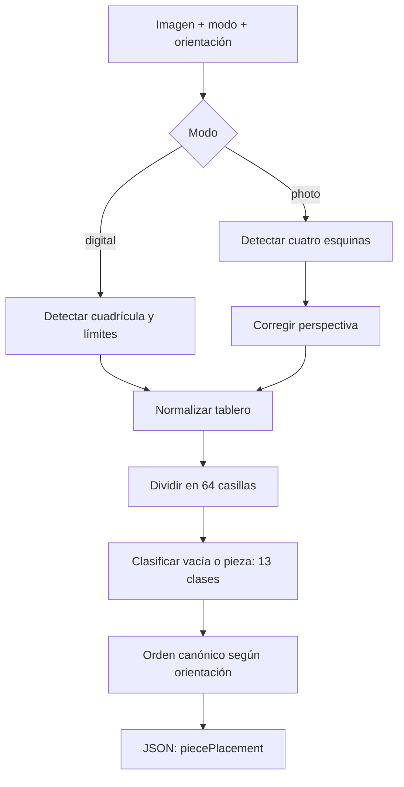
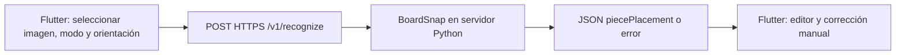

# Informe general de BoardSnap

**Español** | [English](../en/project-status.md)

Estado revisado el **17 de noviembre de 2026**. **BoardSnap es funcional como
motor local y como servicio HTTP de prueba, y ya dispone del recorrido necesario
para empezar la integración Flutter.** Las capturas digitales son la referencia
más consolidada; las fotos de pantallas funcionan con limitaciones y mantienen
estado experimental. No se declara una versión final aceptada.

## Qué hace actualmente

Recibe un PNG/JPEG y obtiene una sola colocación de piezas. Admite dos recorridos:



El modo `photo` corresponde a fotos de **tableros virtuales en una pantalla**,
no a tableros físicos con piezas tridimensionales. La detección usa visión
artificial y geometría de cuadrícula; no se ha entrenado una red de detección de
esquinas. El clasificador de casillas sí usa PyTorch: una CNN pequeña de 39.709
parámetros con entrada RGB de 64×64. Las plantillas originales se conservan para
referencia y compatibilidad.

El modo y la orientación se indican expresamente para la prueba integrada. La
orientación describe la vista, no quién mueve. `auto` sigue disponible para digital,
con blancas abajo cuando no se resuelven las pistas; las fotos requieren orientación
explícita. La app no necesita elegir tema de piezas ni color del tablero.

## Qué devuelve y qué pertenece a Flutter

```json
{"piecePlacement":"rnbqkbnr/pppppppp/8/8/8/8/PPPPPPPP/RNBQKBNR"}
```

Es únicamente el primer campo FEN. No añade turno, enroques, captura al paso,
contadores, confianza, alternativas ni confirmaciones. Si no puede procesar una
imagen devuelve un error estructurado. Si clasifica mal una pieza, la app permitirá
corregirla en su editor. BoardSnap no incluye interfaz ni análisis de partidas.

## Arquitectura y herramientas disponibles

| Área | Responsabilidad |
| --- | --- |
| `src/boardsnap/image_input.py` | Decodificación, formato, EXIF y errores de entrada |
| `detection.py`, `photo_detection.py` | Límites digitales o esquinas fotográficas |
| `normalization.py`, `rectification.py`, `segmentation.py` | Recorte, perspectiva y 64 casillas |
| `orientation.py` | Vista y orden canónico |
| `classification.py`, `neural.py` | Plantillas y clasificación PyTorch |
| `output.py`, `pipeline.py` | Colocación FEN y conexión de etapas |
| `adapters/cli.py`, `adapters/http.py` | Transportes separados del núcleo |
| `tools/` | Capturas, anotación, datasets, entrenamiento, informes y comprobaciones |
| `data/manifests/`, `data/reports/` | Procedencia, recetas, particiones, hashes y resultados |
| `tests/` | Pruebas por etapa y de integración |
| `docs/en/`, `docs/es/` | Documentación en ambos idiomas |
| `.cache/` | Imágenes, recortes, modelos y artefactos locales generados, ignorados por Git |

Hay captura automatizada configurable para Lichess y Chess.com, variantes con
marcas/flechas, importación y revisión fotográfica, exportación de casillas,
auditorías de solapamiento, entrenamiento reproducible y comparación por clase,
posición y condición. No se debe confundir el volumen de variantes con posiciones
o partidas independientes.

## Modelos actuales y qué significan sus resultados

| Uso | Modelo | Decisión actual |
| --- | --- | --- |
| Capturas en la configuración de prueba | `neural-tolerance-v1-conservative/best.pt` | Referencia digital existente |
| Referencia fotográfica | `neural-phone-v1/best.pt` | Se conserva como control |
| Fotos en la configuración de prueba | `neural-mixed-sqrt-v1/last.pt` | Experimental, no promocionado |

Las rutas completas y SHA-256 están en [local-trial-v1.json](../../data/manifests/local-trial-v1.json).
No se sobreescribieron las referencias. El candidato fotográfico reduce el
ponderado inverso de frecuencia usando raíz cuadrada y conserva el repaso mixto y
la exclusión de objetivos erróneos sobre vacías. No se ha seguido entrenando después
de observar el último resultado.

### Evidencia fotográfica consultada

| Medida, 30 fotos | phone-v1 | Candidato |
| --- | ---: | ---: |
| Posiciones correctas con esquinas anotadas | 19/30 | 20/30 |
| Posiciones correctas con detección automática | 20/30 | **22/30** |
| Tableros detectados | 29/30 | 29/30 |
| Casillas correctas en las 29 fotos detectadas | 1.824/1.856 | **1.839/1.856** |
| Vacías convertidas en piezas, recorte automático | 3 | **2** |
| Piezas omitidas, recorte automático | 18 | **8** |

La mejora del recorrido real se mantiene: recupera `chesscom-img_5398` y
`video-img_5406` sin perder ninguno de los veinte aciertos anteriores. Por categoría,
el candidato acierta 6/10 Chess.com, 8/10 Lichess y 8/10 vídeos.

Siguen fallando siete posiciones (`chesscom-img_5395`, `5397`, `5401`, `5402`,
`lichess-img_5391`, `5392`, `video-img_5404`) y la detección de `video-img_5403`.
Entre las dificultades: peones finos, confusiones de color/tipo, madera, muaré e
interferencias fuertes de pantalla. Las dos fotos de peones finos siguen sin quedar
completamente correctas. [Detalle de la comparación](mixed-sqrt-cli.md).

**22/30 no es una promesa de acierto para usuarios nuevos.** Son pocas fotos, ya
consultadas para tomar decisiones y con parte de su procedencia histórica sin
resolver. Los recortes anotados y automáticos dan resultados distintos. El candidato
sigue fallando los criterios originales de conservación con límites anotados:
cinco piezas falsas frente a tres de phone-v1. El éxito de rendimiento o HTTP no
elimina ese incumplimiento.

### Evidencia digital: distinguir modelos y conjuntos

La comparación reciente de 36 capturas reales/casos originales usó **phone-v1**
frente al candidato fotográfico: 35/36 frente a 33/36. Este último pierde
`real-use-6` y `real-use-12`. Ambos resuelven los seis casos originales.
Por eso el modelo fotográfico no se utiliza para capturas en la configuración actual.

El **modelo digital conservador seleccionado** resuelve 40/40 capturas representativas
de validación en la medición CPU reciente. Ese lote es diferente de las 36 capturas;
no se le atribuye el 35/36 de phone-v1. El historial digital contiene además corpus
más amplios y regresiones; deben consultarse con sus modelos y versiones concretos.

## Cobertura de estilos

El corpus digital incluye piezas Lichess Cburnett, Alpha, Merida y Staunty, y
Chess.com Neo, Classic, Bases y Alpha, sobre fondos planos y algunas texturas.
Hay capturas con ambas orientaciones, varios tamaños, márgenes, resaltados,
círculos, puntos, flechas y cruces. No se ha demostrado toda combinación posible.

El catálogo fotográfico tiene siete entradas objetivo y catorce parejas planificadas,
con apariencias observadas que no siempre se han vinculado a un selector oficial.
No equivalen a siete diseños oficiales compatibles. Las capturas de navegador no
prueban aplicaciones móviles nativas; tampoco las fotos de un monitor prueban
cualquier cámara, pantalla, reflejo, desenfoque o perspectiva.
Los diagramas de libros permanecen fuera del alcance de esta primera versión,
aunque existan herramientas y trabajo histórico sobre ellos.

## Datos y entrenamientos recientes

El plan digital utiliza 80 posiciones y mantiene todas sus variantes en su partición.
El conjunto mixto de entrenamiento combina datos digitales con 160 fotos anteriores
y 24 dirigidas nuevas: 184 tableros fotográficos, no 184 partidas independientes.
El muestreo fijo tiene 32.000 casillas con proporciones controladas. Se conserva la
relación con imagen, posición, grupo y partición, y se auditan solapamientos conocidos.
Procedencias desconocidas impiden asegurar independencia completa del material antiguo.

Se probaron de forma acotada la mezcla, la exclusión de imitación errónea en vacías
y el ponderado por raíz cuadrada. La última intervención mejora parcialmente la
validación, pero no autoriza a encadenar más experimentos ni a relajar criterios.
El conjunto final independiente sigue sin utilizarse en estas tareas.

## Tiempo y memoria en esta CPU

Intel Core i5-10400, Linux, cuatro hilos PyTorch y uno OpenCV, un modelo residente:

| Recorrido | Mediana | p95 | Máximo RSS |
| --- | ---: | ---: | ---: |
| Captura con modelo digital conservador | 0,448 s | 0,519 s | 317 MiB |
| Foto con candidato experimental | 1,040 s | 2,782 s | 427 MiB |

El clasificador aislado de 64 casillas tarda aproximadamente 1,3 ms. La mayor parte
del tiempo fotográfico corresponde a las etapas anteriores. Estos valores pasan
los límites locales fijados, pero no son medidas de un teléfono, de la red ni del
servidor con ambos modelos cargados. [Metodología](local-trial.md).

## Estado de HTTP y Flutter

El adaptador HTTP ya carga/verifica ambos modelos, recibe multipart, limita bytes,
aplica modo/orientación, elimina temporales y devuelve JSON/errores con cabeceras
de versión y CORS configurable. Ocho casos coinciden con la CLI mediante HTTPS
local con certificado validado. Trece pruebas adicionales de solicitud/CORS y 97
pruebas dirigidas pasan. [Informe del adaptador](http-server.md).

El servicio no se ha desplegado públicamente. No existe todavía el cliente Flutter,
ni se han probado Android, iOS o navegador Flutter real. El camino previsto es:



La configuración actual permite comenzar una **versión de prueba** de la app. No
proporciona reconocimiento sin conexión: ejecutar en el dispositivo exigiría
trabajo adicional de exportación/runtime nativo y medición móvil.

## Qué queda para una primera aplicación de prueba

1. Conectar Flutter con el endpoint: bytes, `inputType`, orientación y URL configurable.
   Mostrar errores de red/servicio y cargar la colocación en el editor.
2. Preparar un servicio alcanzable por los dispositivos, con HTTPS, orígenes web,
   pesos versionados y límites/capacidad de despliegue. La comprobación local no
   sustituye ese trabajo.
3. Probar el flujo en Android, iOS y web reales, incluidas cancelaciones, timeout,
   reintentos y correcciones del usuario.
4. Mantener visible el estado experimental fotográfico y recoger fallos útiles con
   referencias revisadas, sin mezclarlos con evaluación final.
5. Antes de una versión declarada aceptada, fijar el alcance y una política adecuada
   y ejecutar evaluación independiente. Si se usan esos resultados para corregir,
   pasan a desarrollo y se necesita otro conjunto independiente.

La mejora del reconocimiento fotográfico puede continuar en paralelo a Flutter;
no hace falta resolver cada foto difícil para probar la aplicación. Sí hay que
conservar las limitaciones y evitar presentar como validación independiente los
mismos casos usados para ajustar el sistema.
